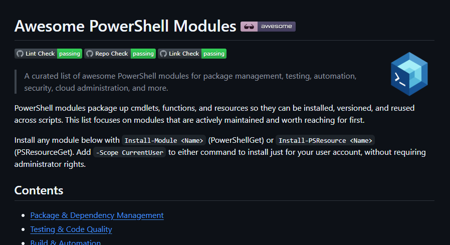
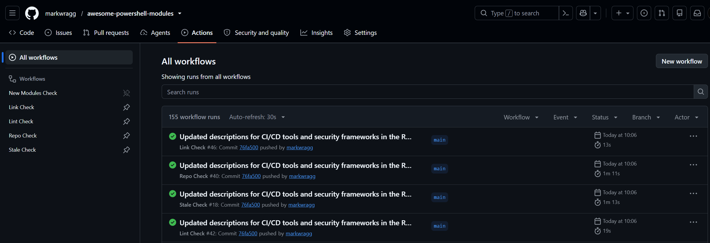
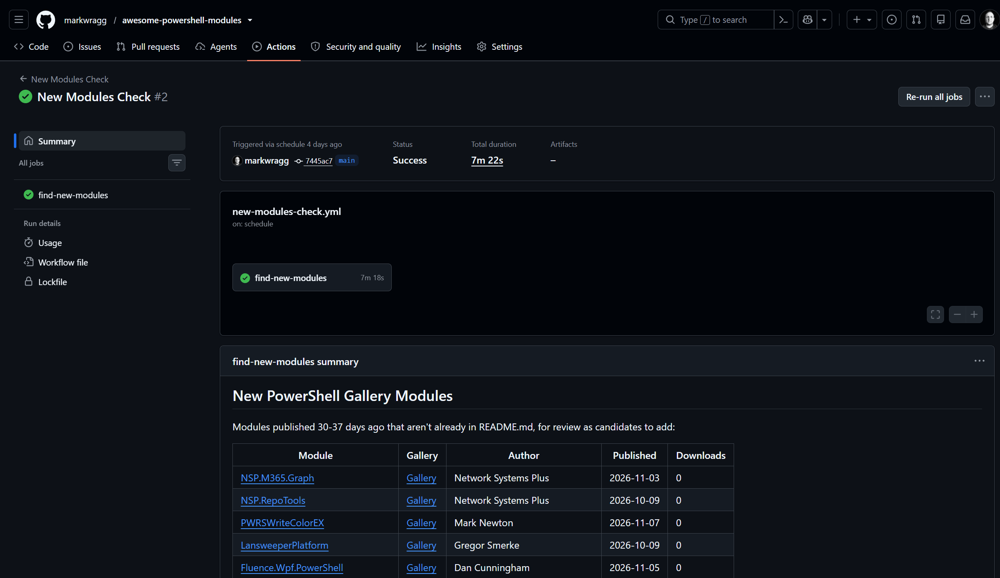

I recently published an [awesome-powershell-modules](https://github.com/markwragg/awesome-powershell-modules) list to GitHub, a curated ["awesome list"](https://github.com/sindresorhus/awesome) of PowerShell modules covering package management, testing, automation, security, cloud administration and more. This blog post covers why I created it, how the repo's GitHub Actions pipelines keep it from going stale, and how I've integrated Claude to help review and triage new module submissions each week.

{: .align-center}

### What is an awesome list?

An awesome list is a _"a community-curated collection of the best resources, tools, libraries, frameworks, and guides dedicated to a specific topic"_. The idea isn't to list everything for a specific topic, but to curate a list of truly "awesome" resources (which as a British person, is not a word I'm _that_ comfortable with overly using). The concept of an awesome list has been around for a while, but was popularised / standardised by [Sindre Sorhus](https://github.com/sindresorhus) in 2014, and he maintains the de facto [list of lists](https://github.com/sindresorhus/awesome).

Awesome lists are generally very easy to create, you just write your list in Markdown, as a `README.md` published in a GitHub repo (or other public location). The preference is to organise the resources into categories, link to their source, and provide a short description that explains why they are awesome.

### Why create a new list?

I had a quick search before I started and discovered a couple of pre-existing PowerShell awesome lists:

- [https://codeberg.org/janikvonrotz/awesome-powershell](https://codeberg.org/janikvonrotz/awesome-powershell)
- [https://github.com/luke-beep/awesome-powershell](https://github.com/luke-beep/awesome-powershell)

However both were general PowerShell lists, which included modules along with other useful resources like blogs, books, podcasts etc., and didn't look to be too actively maintained. I wanted to create something that was specifically about PowerShell modules, to give the community a new resource to find not only the most well known / used tools, but some of the hidden gems as well.

The PowerShell Gallery (at time of writing) has 17,084 unique packages, and while you can search it directly, it's not always obvious what a package does, or whether it is well maintained / working. An awesome list helps with this by adding a layer of human recommendation / curation. Like a museum, or art gallery, the idea is to showcase awesomeness.

To ensure a certain level of discernment, my list has the following rules for contributions:

- All modules must be free and open source. It doesn't exist to advertise commercial products. It does however include free / open source modules that interact with paid tools, but the module itself should not be a paid tool (or exist solely to unlock a paid tool).
- Modules should have existed for at least 30 days, prior to inclusion. I know from my own experience that newly published modules are often still under regular development in the early days, so I want a cooling off period to account for this.
- Modules must not be archived, deprecated or unmaintained for a long period (unless it's simply because they're considered feature complete). I'm a little loose with this rule because there are some modules on the list that I (and many people) use and haven't been maintained for quite a while. Their general importance in the community forgives their lack of maintenance.
- Modules should be relatively unique in their functionality vs other modules on the list. If someone submits a module that is a better alternative to an existing one, it should replace it.

### Keeping the list current with GitHub Actions

Although the list is very new, I was concerned that it could become outdated / stale very easily (particularly as / when my interest might drift elsewhere). Links can break, active repos can get archived, modules can become incompatible or stop being maintained. To gate against this, four GitHub Actions workflows run on a schedule (and on push / PR) to catch this automatically:

{: .align-center}

- **`awesome-lint.yml`** - runs `npx awesome-lint` on push/PR to enforce the awesome-list conventions (formatting, alphabetical order, description style).
- **`link-check.yml`** - runs [lychee](https://github.com/lycheeverse/lychee-action) weekly against README.md to find dead links, with its own cache to avoid re-checking everything every run.
- **`archived-check.yml`** - runs [Test-ArchivedRepos.ps1](https://github.com/markwragg/awesome-powershell-modules/blob/main/scripts/Test-ArchivedRepos.ps1) weekly, which extracts every `github.com/<owner>/<repo>` link from README.md and checks the GitHub API for `archived: true`. This has an `-ExcludeRepo` switch for repos archived deliberately (e.g. `PowerShell/SecretManagement`, archived by the PowerShell team as "feature complete" rather than abandoned).
- **`stale-check.yml`** - runs [Test-StaleRepos.ps1](https://github.com/markwragg/awesome-powershell-modules/blob/main/scripts/Test-StaleRepos.ps1) weekly, flagging any linked repo with no push in over 5 years (configurable), emitting `::warning::` annotations so they surface in the Actions UI. This doesn't automatically exclude a module from the list, but highlights ones worth reviewing.

### Discovering new modules automatically

The idea of an awesome list is that the wider community contributes to the ongoing maintenance (and I hope people do). However, I also wanted to make sure that I was regularly looking for new modules, and didn't want this to be a manual chore, as there may be [100s of new modules published each week](https://jdhitsolutions.com/blog/github/8999/hey-psgallery-whats-new/).

The initial list was curated with AI assistance. To start with, there were a few modules that I had used regularly for many years, some as part of my PowerShell build pipelines, others as day to day tools in the terminal. I also wanted to showcase some of my own modules, so took the opportunity to add my [nepo babies](https://en.wikipedia.org/wiki/Nepo_baby). I also took recommendations from the other awesome lists I noted above. Following this, I used Claude Code to do a scan of some well known community resources to find modules they had mentioned over the years. I had it review the RSS feed of [The PowerShell Podcast](https://powershellpodcast.podbean.com/), [PowerShell Weekly newsletter](https://psweekly.dowst.dev/) and [PowerShell.news](https://www.powershell.news/) site. These weren't all known to me, so I leaned on Claude to help me understand their purpose, and where they were unique or superior to existing items on the list. Claude was great for this, as it was able to quickly summarise what each module did, review its code for any security concerns, and consider whether it was new, unique and awesome enough to join the list. The ultimate decision still falls to me, but Claude took the heavy lifting out of understanding a large number of modules.

To make this a routine task, I had Claude add it as another GitHub Workflow Action, named [New Modules Check](https://github.com/markwragg/awesome-powershell-modules/actions/workflows/new-modules-check.yml).

{: .align-center}

This does the following:

- [scripts/Find-NewGalleryModules.ps1](https://github.com/markwragg/awesome-powershell-modules/blob/main/scripts/Find-NewGalleryModules.ps1) queries the PowerShell Gallery's OData feed, looking for modules whose **first-ever** version was published 30-37 days ago (to comply with my "must have existed for 30 days" rule).
  - This was actually a little finicky, as the gallery returns the latest publish date of modules by default, so we have to further filter to find the genuinely new ones, and to ensure we don't miss ones that are getting updated more than every 30 days.
- Already-listed modules are excluded first (by normalised name and by Gallery ID parsed out of existing README links), so that lookup cost is only paid for genuinely new candidates.

Initially, this just listed the new modules in a markdown table output on the job. It still does this, but it now also goes a step further:

### Letting Claude triage the candidates

The GitHub Action workflow `new-modules-check.yml` runs weekly (or can be run manually):

1. Runs `Find-NewGalleryModules.ps1` and writes the results to the job summary as a markdown table *and* to `candidates.json`.
2. If there are candidates, calls [`anthropics/claude-code-action@v1`](https://github.com/anthropics/claude-code-action) with a scoped tool allow-list (no unrestricted shell) and a prompt that:
   - Gives Claude the same inclusion criteria as human contributors get in `CONTRIBUTING.md` (actively maintained, single clear purpose, documented, not a near-duplicate of something already listed).
   - Asks it to look at each candidate's project/Gallery links (and source repo) and decide include/exclude with one concise reason each.
   - For includes: insert into the correct existing category, alphabetically, matching the exact `- [Name](url) - Description.` format and tone.
   - For excludes: don't touch the README at all.
   - If anything was added: create a branch named `new-modules/<date>`, commit, push, and open a PR with `gh pr create`, with a body listing every candidate under "### Added" / "### Not added" headings.
   - If nothing was a good fit: skip the PR entirely and just append the reasoning to the job summary - avoids opening noise PRs just to say "no".
3. Explicitly never pushes to `main` - the model's only path to changing the list is a PR, which I still review and merge myself.

The first run opened [PR #1](https://github.com/markwragg/awesome-powershell-modules/pull/1) against ~51 candidates found in the Gallery, and suggested:

- Adding **PSZoxide** and **PWRSWriteColorEX**, each with a one-line justification.
- Excluding the rest with specific, varied reasoning - e.g. recognising a family of 9 `IdentityCommand.*` vendor SDK modules as "same family, too new to judge" rather than listing each individually, spotting `TerminalGlyphs` as a near-duplicate of the already-listed Terminal-Icons, and rejecting internal/plumbing modules (`NSP.RepoTools`, `Boyles.PowerShell.Core`) that aren't general-purpose.

I then human-reviewed the PR, and didn't entirely agree. `PWRSWriteColorEX` was a Rust re-implementation of `PSWriteColorEX`, that itself overlapped with an existing list entry `PSWriteColor`, so I dropped it from the PR. `TerminalGlyphs` was a near duplicate of `Terminal-Icons`, but fixed a significant bug from it, due to it no longer being maintained. It was therefore a better alternative, and I added it to the list as a replacement.

While it wasn't perfect, it still added a lot of value so I'm intrigued to see what it suggests in the weeks to come.

### Scripts for visibility into the list itself

In addition to the above, I added a couple of scripts to the repo that you can use to query the list itself. Several of the modules on the list come from the same author, so I was interested to know who was the most prolific, you can find that out via [Get-ModuleAuthor.ps1](https://github.com/markwragg/awesome-powershell-modules/blob/main/scripts/Get-ModuleAuthor.ps1).

Then I thought it might be interesting to be able to list all of the modules on the list as PowerShell objects, along with their download counts. [Get-ModuleDetails.ps1](https://github.com/markwragg/awesome-powershell-modules/blob/main/scripts/Get-ModuleDetails.ps1) lets you do that.

### Reflections

This was my first experience incorporating an LLM into an automation pipeline. Some reflections include:

- Treat the AI like any other contributor: least-privilege tool access, output constrained to a PR for review, no direct write access to `main`.
- Give it the *same written criteria* as human contributors (reusing `CONTRIBUTING.md` language in the prompt) to keep its decisions consistent with how I'd judge them myself.
- Use scripts for the scriptable bits: I don't want the LLM to be generating a solution for querying the gallery on every run, which could then end up being inconsistent as well as wasteful.
- Keep the human in the loop: Awesome lists are supposed to be human curated, and we don't want to lose that by overly relying on AI input.

### Conclusion

While I am hopeful that PowerShell community members (new and old) find this is a useful resource, it wasn't an entirely selfless act (not least because it's a surreptitious way to advertise some of my own modules). I've already found some great new modules to add to my tool chest through the process.

{: .align-center}

Some of my favourite new discoveries include:

- [ConsoleMonster](https://github.com/EvotecIT/ConsoleMonster#readme) - This beast of a module can be used to create incredible looking dashboards directly in the terminal, but just by simply running `Enable-ConsoleFormatting` it also transforms your every day output, making things like Format-Table output much prettier.
- [TerminalGlyphs](https://github.com/marr-cloud/TerminalGlyphs#readme) - Adds icons/colors to files and folders in `Get-ChildItem`. As mentioned above, this is a reimplementation of `Terminal-Icons` and fixed an issue that was occurring when you had multiple tab/sessions, so replaced it on the list as a superior option.
- [PSZoxide](https://github.com/InfiniteRoomLabs/PSZoxide#readme) - A PowerShell clone of zoxide, which I'd not heard of, but is a "smarter cd". Instead of using `cd` you use `z` to navigate a path, and it retains a history which means next time you can use a subset of the path to return to the same place.

If you have any suggestions for modules to add to the list, please let me know. You can either raise an [Issue](https://github.com/markwragg/awesome-powershell-modules/issues) (if you're not confident with GitHub) or a [PR](https://github.com/markwragg/awesome-powershell-modules/pulls). Please review the [CONTRIBUTING.md](https://github.com/markwragg/awesome-powershell-modules/blob/main/CONTRIBUTING.md) guide for more details.
