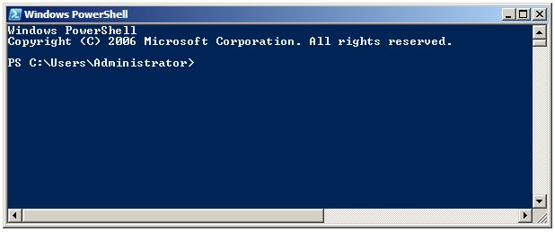

I recently attended a [20th Anniversary celebration of PowerShell](https://www.linkedin.com/events/powershell20-oneideathatchanged7516902171808907264/theater/), hosted by [Heiko Brenn](https://www.linkedin.com/in/heikobrenn/). I wasn't a day one adopter of PowerShell, but I think I was first encouraged by a colleague to use it around 2013, and have been smitten ever since.

I wasn't unfamiliar with scripting at the time, having written things in QBasic when I was a kid, and later Visual Basic and VBScript in college and once I was in the world of work. But I must confess, I was initially resistant to picking up something new. However (like many in the community) it didn't take me long to get hooked.

{: .align-center}

*Why so blue PowerShell? You're still young.*
{: .text-center}

Once you come to appreciate the object pipeline nature of PowerShell it's hard not to love. And there's a lot to be said for it being both a CLI and scripting language. I saw someone describe it recently as being akin to working permanently in debug mode, because of how easy it is to inspect variables as you go along. Part of its endearing versatility is that you can use it as easily to write a complex script, as get a quick answer from a terminal.

[Jeffrey Snover](https://en.wikipedia.org/wiki/Jeffrey_Snover) is typically credited as the creator of PowerShell. He wrote the original "[Monad Manifesto](https://devblogs.microsoft.com/powershell/monad-manifesto-the-origin-of-windows-powershell/)" back in 2002 that proposed an object-based shell for Windows. He then spent years fighting internal resistance at Microsoft to get it built. But he has always been quick to deflect sole credit:

> "People give me too much credit for PowerShell. PowerShell is great because we had a series of rockstar engineers add their awesomeness to the project."
>
> -- Jeffrey Snover, [An Interview With PowerShell Inventor Jeffrey Snover](https://hackernoon.com/an-interview-with-powershell-inventor-jeffrey-snover) (HackerNoon, December 2021)

Jeffrey often specifically calls out individuals like [Bruce Payette](https://github.com/brucepay) (co-designer of the language itself) among the team who actually built it. I was reminded of this watching the 20th anniversary celebration (embedded below) on LinkedIn, where Snover was once again keen to credit the work of others, including Kenneth Hansen, a long-time member of the PowerShell team, who co-hosted the 10th anniversary celebration with Snover back in 2016 too.

<iframe width="560" height="315" src="https://www.youtube.com/embed/P_unk_59wWs" title="PowerShell 20th Anniversary Celebration" frameborder="0" allow="accelerometer; autoplay; clipboard-write; encrypted-media; gyroscope; picture-in-picture" allowfullscreen></iframe>


### A (very abridged) version history

PowerShell has gone through many iterations, improving each time. It has currently branched into two major versions, Windows PowerShell 5.1 (largely considered feature complete, but still maintained for bugs/security issues and bundled with Windows operating systems), and PowerShell Core (now known just as version 7) that is built on .NET Core, and enabled PowerShell to be cross-platform. Here's a quick summary of the major versions:

| Version | Shipped | Notable changes |
|---|---|---|
| 1.0 | Nov 2006 | ~129 cmdlets, the object pipeline, .NET integration - a real automation engine, not just a text shell |
| 2.0 | Oct 2009 (Win7 / Server 2008 R2) | Remoting, modules, ISE |
| 3.0 | Sep 2012 (Win8 / Server 2012) | Workflows, scheduled jobs |
| 4.0 | Oct 2013 (Win8.1 / Server 2012 R2) | Desired State Configuration |
| 5.0 / 5.1 | 2016 (Server 2016) | Classes, PowerShellGet, the Gallery |
| 6.0 "Core" | Jan 2018 | Open source, cross-platform, .NET Core |
| 7.0 | Mar 2020 | .NET Core 3.1, Windows compatibility layer, ternary operator, `&&` / `\|\|` pipeline chains, `ForEach-Object -Parallel` |
| 7.1 | Nov 2020 | .NET 5 |
| 7.2 LTS | Nov 2021 | Concise error view on by default, `$PSStyle` for ANSI/colour output |
| 7.3 | Nov 2022 | .NET 7, official Windows ARM64 support, native command argument passing improvements |
| 7.4 LTS | Nov 2023 | .NET 8, `$PSNativeCommandUseErrorActionPreference` - native command failures can now respect `$ErrorActionPreference` |
| 7.5 | Jan 2025 | .NET 9, array/pipeline cmdlet refinements |
| 7.6 LTS | Mar 2026 | .NET 10 LTS, replaced `BinaryFormatter` with a secure implementation (fixing `Out-GridView`), tab-completion fixes |
| 7.7 (STS) | Nov 2026 | .NET 11, security hardening (Constrained Language Mode, implicit remoting), `New-TemporaryDirectory` |

### How it shaped my career

My early experience with PowerShell was to use it as a force multiplier, via [PSRemoting](https://learn.microsoft.com/en-us/powershell/scripting/learn/remoting/running-remote-commands). I was actually in a managerial role at the time, but had been promoted from an engineering role and was still fairly hands on. I often found myself needing to audit our VMware VM estate (that was around 300 VMs), to answer questions. PowerShell was great for this. I'd have a CSV file with my list of VMs, extracted from Active Directory, and a `ForEach` loop would connect to each of them using my AD credentials to gather some intel.

```powershell
$Servers = Import-CSV .\servers.csv

$Credential = Get-Credential

ForEach ($Server in $Servers) {
    Invoke-Command -ComputerName $Server.Name -Credential $Credential -ScriptBlock {
        [PSCustomObject]@{
            ComputerName = $env:COMPUTERNAME
            OS           = (Get-CimInstance Win32_OperatingSystem).Caption
            LastBoot     = (Get-CimInstance Win32_OperatingSystem).LastBootUpTime
            FreeSpaceGB  = [math]::Round((Get-PSDrive C).Free / 1GB, 1)
        }
    }
}
```

Once comfortable with the language I was encouraged to look at [Pester](https://pester.dev), which was becoming the de facto PowerShell testing framework. I was a little resistant at first, because it felt like a whole new set of terminology to learn (I didn't understand why my scripts started with `$SUT` or what that was supposed to mean. It was "System Under Test" I believe). Once I had got my head around the concept, I once again fell in love. As someone that came from an Operations background, the idea of testing code with other code was very new to me. But I quickly came to appreciate the power of it, particularly when paired with things like source control and CI/CD pipelines. However another great use I found for Pester early on was to do Infrastructure / Application validation checks. At the time we had a very manual list of checks that we'd do after a deployment or change, and writing a Pester script to automate these added a very useful quality gate to my team's work.

For a while I haunted the [PowerShell](https://stackoverflow.com/questions/tagged/powershell?tab=Newest) and [Pester](https://stackoverflow.com/questions/tagged/pester?tab=Newest) tags on StackOverflow. This proved to be a great way to challenge myself, and I learnt a lot while racing to answer the questions of others. The amazing thing about this is that every now and then I'll Google some PowerShell concept that I've forgotten only to end up back at one of my own answers :).

### Publishing, community, and the Gallery

As I covered in a [previous blog post](https://wragg.io/how-i-became-a-powershell-millionaire/), I have a number of PowerShell modules published in the [PowerShell Gallery](https://www.powershellgallery.com/profiles/markwragg). This was another learning curve for me, the idea of packaging up cmdlets into a module and putting them somewhere other people could then use was quite intimidating. But I soon came to discover that the process is actually very simple. Thankfully others did too, and PowerShell now benefits from a vibrant community, who have published over 17,000 modules to the gallery and counting.

I recently started an [awesome list of PowerShell modules](https://github.com/markwragg/awesome-powershell-modules) to aid in the discovery of my favourite of these. With a gallery that populous it can be hard to know where to start, and there's some fantastic well known and lesser known tools in there. If you have any ideas for modules to include in the list (your own, or others) please do let me know or raise a PR. The list is intended to be partly self maintaining, as [I blogged about previously](https://wragg.io/awesome-powershell-modules/), by using Claude to do a weekly assessment of modules published in the last 30 - 37 days and consider them for inclusion. The final decision still rests with a human maintainer.

Like a lot of people, so much of my work has come about by standing on the shoulders of giants. I learnt so much from leaders in the community such as [Richard Siddaway](https://richardspowershellblog.wordpress.com) and [Warren Frame](https://ramblingcookiemonster.github.io) on how to write good PowerShell, build pipelines and automation. Books such as [Learn PowerShell in a Month of Lunches](https://www.manning.com/books/learn-powershell-in-a-month-of-lunches) were also a great help in getting started. I've dipped in and out of the [PowerShell Discord](https://discord.gg/powershell) / Slack account, but have found it to always be a welcoming community. It was a pleasure to be a guest on [The PowerShell Podcast](https://pdq.com/resources/the-powershell-podcast/ep-109-cloud-chronicles-mark-wraggs-journey-in-devops), and speak at the [Southampton PowerShell Usergroup](https://www.meetup.com/PowerShell-Southampton), as well as PSDay.UK in [2018](https://www.youtube.com/watch?v=BbOiQCgDDR8) and [2019](https://www.youtube.com/watch?v=V7PYt9tWFw8) and more recently [PSConf.eu's MiniCon](https://www.youtube.com/watch?v=x5LXjIPEflU). At every one of these events I met enthusiastic people just keen to help others succeed.

### The next 20 years

I hope that PowerShell continues to be the powerhouse tool it has come to be. With AI and LLMs you can certainly write more PowerShell more quickly than ever before. I think it will continue to be an important tool for new and existing users alike, particularly because of its easy to read / understand nature. I also hope the PowerShell community continues to be the warm and inclusive place I've found it to be.

Here's to the next 20 years.

---

How has PowerShell impacted your life or career? Let me know in the comments below.
