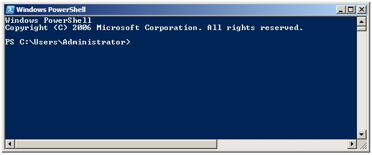

I recently attended a 20th Anniversary celebration of PowerShell. I haven't been using PowerShell since day one, but was encouraged to use it around 2013, and have adored it ever since. I wasn't unfamiliar with scripting at the time, having written things in QBasic when I was a kid, and later Visual Basic and VBScript in college and once I was in the world of work. But I must confess, I was initially resistant to picking up something new. However (like many in the community) it didn't take me long to get hooked.

{: .align-center}

Once you come to appreciate the object pipeline nature of PowerShell it's hard not to love. And there's a lot to be said for it being both a CLI and scripting language. I saw someone describe it recently as being akin to working permanently in debug mode, because of how easy it is to inspect variables as you go along. Part of it's endearing versatility is that you can use it as easily to write a complex script, as get a quick answer from a terminal.

[Jeffrey Snover](https://en.wikipedia.org/wiki/Jeffrey_Snover) is typically credited as the creator of PowerShell. He wrote the original "[Monad Manifesto](https://devblogs.microsoft.com/powershell/monad-manifesto-the-origin-of-windows-powershell/)" back in 2002 that proposed an object-based shell for Windows, and spent years fighting internal resistance at Microsoft to get it built. But he has always been quick to deflect sole credit:

> "People give me too much credit for PowerShell. PowerShell is great because we had a series of rockstar engineers add their awesomeness to the project,"

 Jeffrey often specifically calls out individuals like [Bruce Payette](https://github.com/brucepay) (co-designer of the language itself) among the team who actually built it. I was reminded of this watching the 20th anniversary celebration (embedded below) on LinkedIn yesterday, where Snover was once again keen to credit the work of others, including Kenneth Hansen, PowerShell's long-time Lead Program Manager, who's been there since close to the start and co-hosted the 10th anniversary celebration with Snover back in 2016 too.

<iframe width="560" height="315" src="https://www.youtube.com/embed/P_unk_59wWs" title="PowerShell 20th Anniversary Celebration" frameborder="0" allow="accelerometer; autoplay; clipboard-write; encrypted-media; gyroscope; picture-in-picture" allowfullscreen></iframe>

### A (very abridged) version history

PowerShell has gone through many iterations, improving each time. It has currently branched into two major versions, Windows PowerShell 5.1 (largely considered feature complete, but still maintained for bugs/security issues and bundled with Windows Operating systems), and PowerShell Core (now version 7) that is built on .NET Core, and enabled PowerShell to be cross-platform. Here's a quick summary of the major versions:

| Version | Shipped | Notable changes |
|---|---|---|
| 1.0 | Nov 2006 | ~129 cmdlets, the object pipeline, .NET integration - a real automation engine, not just a text shell |
| 2.0 | Oct 2009 (Win7 / Server 2008 R2) | Remoting, modules, ISE |
| 3.0 | Sep 2012 (Win8 / Server 2012) | Workflows, scheduled jobs |
| 4.0 | Oct 2013 (Win8.1 / Server 2012 R2) | Desired State Configuration |
| 5.0 / 5.1 | 2016 (Win10 / Server 2016) | Classes, PowerShellGet, the Gallery |
| 6.0 "Core" | Jan 2018 | Open source, cross-platform, .NET Core |
| 7.0 | Mar 2020 | .NET Core 3.1, Windows compatibility layer, ternary operator, `&&` / `\|\|` pipeline chains, `ForEach-Object -Parallel` |
| 7.1 | Jan 2021 | .NET 5, concise error view introduced (experimental) |
| 7.2 LTS | Nov 2021 | Concise error view on by default, `$PSStyle` for ANSI/colour output, Secrets management went GA |
| 7.3 | Nov 2022 | .NET 7, official Windows ARM64 support, native command argument passing improvements |
| 7.4 LTS | Nov 2023 | .NET 8, `$PSNativeCommandUseErrorActionPreference` - native command failures can now respect `$ErrorActionPreference` |
| 7.5 | Jan 2025 | .NET 9, array/pipeline cmdlet refinements |
| 7.6 LTS | Mar 2026 | .NET 10 LTS, replaced `BinaryFormatter` with a secure implementation (fixing `Out-GridView`), tab-completion fixes |
| 7.7 (STS) | Nov 2026 | .NET 11, security hardening (Constrained Language Mode, implicit remoting), `New-TemporaryDirectory`, time-sortable v7 GUIDs by default |

### How it shaped my career

My early experience with PowerShell was to use it as a force multiplier, via [PSRemoting](https://learn.microsoft.com/en-us/powershell/scripting/learn/remoting/running-remote-commands). I was actually in a managerial role at the time, but had been promoted from an engineering role and was still fairly hands on. I often found myself needing to audit our VMWare VM estate (that was around 300 VMs), to answer questions. PowerShell was great for this. I'd have a CSV file with my list of VMs, extracted from Active Directory, and a `ForEach` loop would connect to each of them using my AD credentials to gather some intel.

Once comfortable with the language I was encouraged to look at [Pester](https://pester.dev), which was becoming the defacto PowerShell testing framework. I was a little resistant at first, because it felt like a whole new set of terminology to learn (I didn't understand why my scripts started with `$SUT` or what that was supposed to mean. It was "System Under Test" I believe). Once I had got my head around the concept, I once again fell in love. As someone that came from an Operations background, the idea of testing code with other code was very new to me. But I quickly came to appreciate the power of it, particularly when paired with things like source control and CI/CD pipelines. However another great use I found for Pester early on was to do Infrastructure/Application validation checks. At the time we had a very manual list of checks that we'd do after a deployment or change, and writing a Pester script to automate these added a very useful quality gate to my team's work.

### Publishing, community, and the Gallery

As I covered in a [previous blog post](https://wragg.io/how-i-became-a-powershell-millionaire/), I have a number of PowerShell modules published in the [PowerShell Gallery](https://www.powershellgallery.com/profiles/markwragg). This was another learning curve for me, the idea of packaging up cmdlets into a module and putting them somewhere other people could then use was quite intimidating. But I soon came to discover that the process is actually very simple. Thankfully others did too, and PowerShell now benefits from a vibrant community, who have published over 17,000 modules to the gallery and counting.

I recently started an [awesome list of PowerShell modules](https://github.com/markwragg/awesome-powershell-modules) to aid in the discovery of my favourite of these. With a gallery that populous it can be hard to know where to start, and there's some fantastic well known and lesser known tools in there. If you have any ideas for modules to include in the list (your own, or others) please do let me know or raise a PR. The list is intended to be partly self maintaining, as [I blogged about previously](https://wragg.io/awesome-powershell-modules/), by using Claude to do a weekly assessment of modules published in the last 30 - 37 days and consider them for inclusion. The final decision still rests with a human maintainer.

### Open source and the cross-platform shift

The shift to PowerShell Core was another unexpected turn in PowerShell's journey, but one I greatly appreciate. For a number of years I worked from a Macbook Air, so it was great to be able to natively continue to work with PowerShell. And knowing that I can write automation that can be run on Windows, MacOS and Linux is incredibly powerful. Particularly when it comes to managing resources in the cloud.

### The next 20 years

I hope that PowerShell continues to be the powerhouse tool it has come to be. With AI and LLMs you can certainly write more PowerShell more quickly than ever before. I think it will continue to be an important tool for new and existing users alike, particularly because of it's easy to read / understand nature.

---

How has PowerShell impacted your life or career? Let me know in the comments below.
